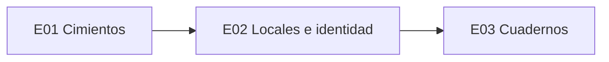

# Épicas y user stories

**Estado: borrador para revisar.** Convenciones, DoR, DoD y releases en [00-como-leer-el-backlog.md](00-como-leer-el-backlog.md). Preguntas sin resolver en [02-preguntas-abiertas.md](02-preguntas-abiertas.md) (se citan como P-nn). Decisiones en [../adr/](../adr/README.md). Los diagramas que se citan (ARQ, CU, CLA, DAT, TEC, FUN, EST, OPS) están en `../diagramas/`.

## Mapa de épicas

| Épica | Objetivo | Release |
|---|---|---|
| E01. Cimientos y entrega continua | Repo, entornos, CI/CD y documentación | R0 |
| E02. Locales, identidad y seguridad | Tenants, aislamiento, ingreso, permisos, auditoría y backups | R1 |
| E03. Cuadernos | Cargar, corregir, venta espejo, reportes, filtros, exportación y puesta en marcha | R1 |

---

## E01. Cimientos y entrega continua

Repositorio, entornos, CI/CD y documentación. Tres entornos: desarrollo, pruebas y producción (ADR-0004). El objetivo es que desplegar sea aburrido.

### HU-001. Repositorio y convenciones
**Prioridad:** Must · **Etiquetas:** `devops`, `docs` · **Diagramas:** ARQ-03, TEC-02

Como desarrollador, quiero un repositorio con estructura y reglas claras, para que los dos trabajemos igual y nadie rompa `main`.

- Dado el repositorio, cuando lo clono, entonces encuentro `backend/` (Django, con las apps `core`, `accounts` y `notebooks`), `frontend/` (React), `docs/` y un README que explica cada carpeta.
- Dado un cambio, cuando intento pushear directo a `main`, entonces GitHub lo rechaza: solo entra por PR con una aprobación y CI en verde.
- Dado un PR, cuando lo abro, entonces aparece una plantilla con qué cambia, cómo se probó, la story y el checklist de la DoD.
- Dado un commit, cuando no sigue Conventional Commits, entonces el hook local o CI avisa.

### HU-002. Entorno de desarrollo reproducible
**Prioridad:** Must · **Etiquetas:** `devops` · **Diagramas:** ARQ-05

Como desarrollador, quiero levantar todo en mi PC con pocos comandos, para empezar a trabajar sin pedir ayuda.

- Dado una PC con Docker, cuando sigo el README, entonces en menos de 15 minutos tengo corriendo la API, el portal y la base.
- Dado el entorno levantado, cuando corro el seed, entonces tengo dos locales ficticios, una persona con dos locales, una con uno solo, una de cada rol, categorías y movimientos de ejemplo, incluidas ventas espejo.
- Dado el seed, cuando lo reviso, entonces no tiene datos reales de clientes.

### HU-003. Esqueleto que camina: un saludo de punta a punta
**Prioridad:** Must · **Etiquetas:** `devops`, `arquitectura` · **Diagramas:** ARQ-02, ARQ-03

Como equipo, queremos un recorrido mínimo que atraviese todas las piezas, para encontrar los problemas de integración antes de escribir negocio.

- Dado el portal, cuando una persona de prueba ingresa y escribe un saludo, entonces la API lo guarda en la base bajo su local y lo muestra con su hora.
- Dado una persona de otro local, cuando entra, entonces no ve ese saludo.
- Dado este recorrido, cuando se mergea a `main`, entonces queda en pruebas sin pasos manuales.
- Dado el esqueleto, cuando una persona ingresa, entonces la sesión es por cookie y toda escritura lleva el token CSRF (ADR-0006).

> Tip: esta story es la que más enseña. Obliga a resolver despliegue, configuración, autenticación, aislamiento entre locales y CI antes de que haya presión por funcionalidades.

### HU-004. Integración continua en cada pull request
**Prioridad:** Must · **Etiquetas:** `devops`, `tests`, `seguridad` · **Diagramas:** TEC-02

Como revisor, quiero que CI valide cada PR, para revisar diseño y lógica en lugar de buscar errores que una máquina encuentra sola.

- Dado un PR, cuando se abre o actualiza, entonces CI corre formato y lint (ruff, oxlint), chequeo de tipos (mypy o pyright, `tsc`), tests (pytest con PostgreSQL en contenedor, vitest) y build.
- Dado una dependencia con vulnerabilidad alta o crítica, o un secreto en el código, cuando corre CI, entonces falla y dice cuál (pip-audit, npm audit, gitleaks).
- Dado código nuevo con un patrón inseguro de severidad alta o crítica, cuando corre CI, entonces el análisis estático lo marca en el PR y bloquea el merge; lo de severidad menor aparece como aviso sin bloquear (Semgrep CE, CodeQL mientras el repo sea público, Ruff `S`; ver ADR-0005).
- Dado migraciones nuevas, cuando corre CI, entonces se aplican sobre una base vacía y sobre una con el seed, y `makemigrations --check` confirma que no falta ninguna.
- Dado una app que importa algo de otra que no debería (por ejemplo, `core` importando de `notebooks`), cuando corre CI, entonces falla (ADR-0002).
- Dado el tiempo de CI, cuando pasa de 10 minutos, entonces se registra como deuda.

### HU-005. Despliegue continuo a pruebas
**Prioridad:** Must · **Etiquetas:** `devops` · **Diagramas:** ARQ-02, ARQ-05, TEC-02

Como equipo, queremos que cada merge a `main` quede en pruebas, para que el cliente pueda probar siempre la última versión.

- Dado un merge a `main`, cuando CI pasa, entonces se despliegan la API con el portal compilado y las migraciones al entorno de pruebas.
- Dado el despliegue, cuando termina, entonces corre un smoke test (salud, ingreso de prueba, lectura de un dato) y avisa si falla.
- Dado pruebas, cuando se usa, entonces tiene su propia base, con datos inventados.

> Pendiente P-04: a nombre de quién se abren las cuentas de hosting.

### HU-006. Promoción a producción con aprobación
**Prioridad:** Must · **Etiquetas:** `devops` · **Diagramas:** ARQ-05, TEC-02

Como responsable, quiero llevar a producción solo una versión probada y aprobada, para que un error de pruebas no llegue al cliente.

- Dado una versión probada, cuando creo el tag `vX.Y.Z`, entonces el pipeline espera aprobación manual en el environment "production" de GitHub.
- Dado la aprobación, cuando se despliega, entonces se promueve el mismo artefacto probado, sin recompilar.
- Dado un problema, cuando sigo el runbook de vuelta atrás, entonces vuelvo a la versión anterior en menos de 15 minutos.
- Dado una migración no compatible hacia atrás, cuando se planifica, entonces se parte en dos despliegues (expandir y después contraer).

### HU-007. Secretos por entorno
**Prioridad:** Must · **Etiquetas:** `seguridad`, `devops` · **Diagramas:** ARQ-05

Como responsable, quiero los secretos de cada entorno fuera del código, para que una filtración del repo no exponga nada.

- Dado cualquier secreto (base, claves, credenciales), cuando se usa, entonces viene de variables de entorno o del almacén de secretos de cada entorno, nunca del repo.
- Dado los tres entornos, cuando comparo sus secretos, entonces son distintos.
- Dado un secreto comprometido, cuando sigo el runbook, entonces lo roto sin redeployar código.

### HU-008. Documentación viva
**Prioridad:** Should · **Etiquetas:** `docs`

Como desarrollador, quiero la documentación en el repo y generada donde se pueda, para que no quede vieja.

- Dado la API, cuando corre CI, entonces se genera el contrato OpenAPI (drf-spectacular) y se publica como artefacto.
- Dado un diagrama Mermaid editado, cuando corro `npm run exportar` en `docs/diagramas/herramientas`, entonces se regeneran SVG, PNG y galería.
- Dado una decisión de arquitectura, cuando se toma, entonces queda un ADR y se actualiza el índice de `docs/adr/README.md`.

---

## E02. Locales, identidad y seguridad

Cada local es un tenant y se entra por membresía (ADR-0003). Ingreso con usuario y contraseña, permisos por rol, auditoría y backups.

### HU-010. Alta de un local
**Prioridad:** Must · **Etiquetas:** `tenants`, `backend` · **Diagramas:** ARQ-04, DAT-01, CU-01

Como equipo, quiero dar de alta un local, para que pueda empezar a usar los cuadernos.

- Dado nombre y zona horaria, cuando creo el local, entonces queda un tenant con identificador único.
- Dado el alta, cuando ocurre, entonces queda auditada.
- Dado un local nuevo, cuando se crea, entonces arranca sin categorías: se cargan las acordadas en la puesta en marcha (HU-029).

> En R1 el alta la hace el equipo desde el admin de Django.

### HU-011. Aislamiento entre locales
**Prioridad:** Must · **Etiquetas:** `tenants`, `seguridad`, `tests` · **Diagramas:** ARQ-04, DAT-01, TEC-01, FUN-01

Como dueño, quiero que ningún otro local vea mis datos, para confiar en el sistema.

- Dado cualquier tabla de negocio, cuando la reviso, entonces tiene `tenant_id` obligatorio y una política de Row Level Security.
- Dado una persona del local A, cuando pide un recurso del local B por su id, entonces recibe 404.
- Dado una consulta cruda que olvida filtrar por local, cuando se ejecuta con el usuario de la app, entonces la base igual la restringe.
- Dado la suite, cuando corre, entonces tiene tests de fuga entre dos locales para cada endpoint de lectura y escritura.

### HU-012. Ingresar al portal y elegir local
**Prioridad:** Must · **Etiquetas:** `auth`, `frontend`, `backend`, `tenants` · **Diagramas:** FUN-01, ARQ-04, CU-01, CU-02

Como persona con acceso al portal, quiero entrar con mi usuario y contraseña y llegar al local que me toca, para trabajar desde cualquier lugar.

- Dado credenciales válidas y una sola membresía activa, cuando ingreso, entonces entro directo a ese local, sin pantalla de selección.
- Dado credenciales válidas y más de una membresía activa, cuando ingreso, entonces elijo el local en una pantalla y entro a ese.
- Dado que estoy dentro de un local y tengo más de uno, cuando uso el selector de la barra, entonces cambio de local sin volver a ingresar. Si tengo uno solo, el selector no aparece.
- Dado credenciales válidas sin membresías activas, cuando ingreso, entonces veo que no tengo acceso a ningún local y queda auditado.
- Dado credenciales inválidas, cuando ingreso, entonces el mensaje no dice si falló el usuario o la contraseña, y queda auditado.
- Dado varios intentos fallidos, cuando paso el umbral, entonces se aplica una espera creciente.
- Dado que olvidé la contraseña, cuando pido recuperarla, entonces recibo un enlace de un solo uso que vence, y al usarlo se cierran las otras sesiones.
- Dado un celular, cuando ingreso, entonces la pantalla de ingreso y la de elegir local se usan sin desplazarse hacia el costado.

> Pendiente P-03: si se ingresa con email o con nombre de usuario. Afecta la recuperación de contraseña.

### HU-013. Membresías y roles
**Prioridad:** Must · **Etiquetas:** `seguridad`, `auth`, `tenants` · **Diagramas:** ARQ-04, CLA-01, DAT-01, FUN-01, CU-01

Como equipo, quiero dar a cada persona acceso a uno o varios locales con un rol, para que cada una vea y haga solo lo suyo.

- Dado una persona y un local, cuando creo una membresía, entonces elijo el rol: dueño, carga o consulta.
- Dado una persona con membresías en dos locales, cuando ingresa, entonces elige entre los dos (HU-012); con una sola, entra directo.
- Dado una persona con roles distintos en dos locales, cuando cambia de local, entonces sus permisos cambian con el local.
- Dado una membresía desactivada, cuando la persona intenta entrar a ese local, entonces no puede; si era la única, no entra a ninguno.
- Dado un cambio de membresía o de rol, cuando ocurre, entonces queda auditado con antes y después.
- Dado los roles, cuando se leen, entonces vienen de la base, nunca de un dato que el usuario pueda editar.
- Dado el código, cuando valida un acceso, entonces pregunta por un permiso ("puede cargar"), no por el nombre del rol.

> En R1 las membresías las crea el equipo desde el admin de Django durante la puesta en marcha (HU-029).

### HU-014. Auditoría de solo agregar
**Prioridad:** Must · **Etiquetas:** `seguridad`, `auditoria` · **Diagramas:** DAT-01, TEC-01, CU-02

Como dueño, quiero un registro que nadie pueda modificar de las acciones importantes, para saber quién hizo qué y cuándo.

- Dado un evento auditable, cuando ocurre, entonces se escribe con actor, acción, entidad, antes, después, motivo, local y hora, en la misma transacción.
- Dado una entrada, cuando alguien intenta editarla o borrarla, entonces la base lo impide (permiso revocado y trigger).
- Dado la auditoría, cuando se consulta, entonces está paginada y filtra por local, actor, acción y fecha.

### HU-015. Endurecimiento base de la API
**Prioridad:** Must · **Etiquetas:** `seguridad`, `backend`, `observabilidad`

Como sistema, quiero las protecciones básicas activas desde el primer despliegue, para no depender de acordarse después.

- Dado cualquier solicitud, cuando no es HTTPS, entonces se redirige o rechaza; las cabeceras de seguridad y CORS están configuradas solo para los orígenes propios.
- Dado cualquier entrada, cuando llega a una vista, entonces la validó un serializer.
- Dado solicitudes repetidas desde un origen, cuando pasan el umbral, entonces se limitan (throttling de DRF).
- Dado una solicitud, cuando se procesa, entonces los logs son estructurados, con id de correlación y sin datos sensibles.
- Dado el endpoint de salud, cuando se consulta, entonces informa si la base responde y qué versión está corriendo.

### HU-016. Backup con restauración probada
**Prioridad:** Must · **Etiquetas:** `ops`, `datos` · **Diagramas:** ARQ-02, OPS-01

Como dueño, quiero que los cuadernos no se pierdan nunca, porque solo viven en la nube.

- Dado la base de producción, cuando es de noche, entonces un job hace `pg_dump`, lo cifra y lo guarda fuera del proveedor de la base, con retención documentada.
- Dado un backup, cuando se restaura en un entorno aislado al menos una vez por mes, entonces se marca verificado. Un backup sin restauración probada no cuenta.
- Dado un backup o una restauración que falla, cuando pasa, entonces el equipo recibe un aviso.

---

## E03. Cuadernos

Reemplazan a los cuadernos de papel del local: ingresos, gastos y haber cargados a mano. Viven **solo en la nube** y son **de cada local** (ADR-0003). No leen ni escriben nada del sistema de caja. Todas sus pantallas se usan desde un celular de 390 px y desde la PC.

> Los campos y las categorías se ajustan después de ver un ejemplo de cada cuaderno de papel (P-01).

### HU-020. Modelo de movimientos y categorías
**Prioridad:** Must · **Etiquetas:** `backend`, `db`, `cuadernos` · **Diagramas:** ARQ-03, CLA-01, DAT-01

Como desarrollador, quiero las tablas de los cuadernos de cada local, para representar bien ingresos, gastos, haber y saldo.

- Dado un movimiento, cuando se crea, entonces tiene local, fecha, tipo, categoría, descripción, importe, medio de pago y quién lo cargó.
- Dado un movimiento o una categoría, cuando se guarda, entonces tiene `tenant_id` obligatorio y la base aplica Row Level Security (HU-011).
- Dado un importe, cuando se guarda, entonces es `numeric(14,2)`, nunca punto flotante.
- Dado una venta espejo, cuando se crea, entonces apunta al gasto que la generó (`mirror_of`), para corregirlos y anularlos juntos (HU-025).
- Dado movimientos en el tiempo, cuando se consultan, entonces se puede calcular el saldo de cualquier período.

> Pendiente P-01: qué es el haber, cómo afecta el saldo y si un local lleva uno o varios cuadernos. El tipo de movimiento queda como una lista cerrada que se pueda ampliar sin migrar datos.

### HU-021. Cargar un movimiento
**Prioridad:** Must · **Etiquetas:** `backend`, `frontend`, `cuadernos` · **Diagramas:** ARQ-01, FUN-02, TEC-01, CU-01

Como persona con rol carga o dueño, quiero anotar un movimiento desde el celular o la PC, para dejar de usar el cuaderno de papel.

- Dado datos válidos, cuando guardo, entonces el movimiento queda en el local activo y aparece en la lista de su día y en el saldo.
- Dado datos inválidos (importe cero o negativo, sin categoría, sin fecha, una categoría de otro tipo o de otro local), cuando guardo, entonces veo un error claro y no se escribe nada.
- Dado un doble toque o un reintento de la red, cuando llega dos veces el mismo pedido, entonces se guarda un solo movimiento (clave de idempotencia).
- Dado un celular de 390 px, cuando cargo un movimiento, entonces el formulario entra sin desplazarse hacia el costado y en el importe aparece el teclado numérico.
- Dado una PC, cuando cargo un movimiento, entonces lo puedo hacer sin el mouse.
- Dado el alta, cuando ocurre, entonces se escribe la auditoría en la misma transacción (HU-014).

### HU-022. Administrar categorías
**Prioridad:** Should · **Etiquetas:** `backend`, `frontend`, `cuadernos` · **Diagramas:** CLA-01, CU-01

Como dueño, quiero administrar las categorías de los cuadernos de mi local, para que los movimientos se ordenen como pienso el negocio.

- Dado categorías de ingreso y de gasto, cuando creo, edito o desactivo una, entonces se refleja en el formulario y en los reportes, y los movimientos pasados conservan la suya.
- Dado una categoría con movimientos, cuando intento borrarla, entonces no se puede: se desactiva.
- Dado dos locales del mismo dueño, cuando creo una categoría en uno, entonces no aparece en el otro.
- Dado la categoría del sistema de las ventas espejo, cuando intento editarla o desactivarla, entonces no se permite.
- Dado los roles carga y consulta, cuando buscan cómo administrar categorías, entonces no lo ven y la API responde 403.

### HU-023. Saldo y reporte del período
**Prioridad:** Must · **Etiquetas:** `backend`, `frontend`, `cuadernos`, `reportes` · **Diagramas:** CU-01

Como dueño, quiero el saldo del período y los totales por mes y por categoría, para ver cómo va el local.

- Dado un período, cuando lo abro, entonces veo total de ingresos, total de gastos, saldo y la comparación de ingresos contra gastos.
- Dado un mes, cuando miro el reporte, entonces veo el total y la cantidad de movimientos de cada categoría.
- Dado un año, cuando miro el reporte, entonces veo los totales de ingresos y gastos de cada mes uno al lado del otro.
- Dado ventas espejo y movimientos anulados, cuando se calculan los totales, entonces los espejos suman como cualquier venta y los anulados no suman.
- Dado un celular, cuando abro el reporte, entonces se lee sin desplazarse hacia el costado.

> Cómo suma el haber se define con P-01.

### HU-024. Permisos por rol
**Prioridad:** Must · **Etiquetas:** `seguridad`, `auditoria`, `cuadernos` · **Diagramas:** FUN-02, FUN-03, CU-01

Como dueño, quiero que cada persona haga solo lo que su rol permite y solo en los locales donde tiene membresía, para que los cuadernos sean confiables.

- Dado el rol consulta, cuando usa los cuadernos, entonces ve movimientos, historial y reportes, y exporta; no ve botones para cargar, corregir, anular ni administrar categorías.
- Dado el rol carga, cuando usa los cuadernos, entonces además carga, corrige y anula; no administra categorías.
- Dado el rol dueño, cuando usa los cuadernos, entonces puede todo lo anterior y administrar categorías.
- Dado cualquier rol, cuando llama directo a la API una acción que su rol no permite, entonces recibe 403 y queda auditado.
- Dado una persona sin membresía en un local, cuando pide un movimiento de ese local por su id, entonces recibe 404 (HU-011).
- Dado un alta, una corrección o una anulación, cuando ocurre, entonces se escribe una entrada de auditoría en la misma transacción con actor, acción, motivo, antes y después.

### HU-025. Venta espejo para gastos que no son en efectivo
**Prioridad:** Must · **Etiquetas:** `backend`, `frontend`, `cuadernos`, `dinero` · **Diagramas:** CLA-01, DAT-01, TEC-01, FUN-02, FUN-03, EST-01, CU-02

Como dueño, quiero que un gasto pagado con débito, crédito, QR o transferencia no baje el saldo, para que el cuaderno refleje la plata que hay, igual que lo anoto en papel.

- Dado un gasto con medio débito, crédito, QR o transferencia, cuando se guarda, entonces en la misma transacción el sistema crea una venta espejo del mismo importe, fecha y local, en la categoría del sistema y con la descripción del gasto.
- Dado un gasto en efectivo, cuando se guarda, entonces no se crea ninguna venta espejo.
- Dado una venta (ingreso) con cualquier medio, cuando se guarda, entonces no genera espejo.
- Dado una venta espejo, cuando alguien intenta editarla o anularla directamente, entonces no se permite: sigue siempre a su gasto (HU-026).
- Dado la lista, cuando muestra una venta espejo, entonces la marca como espejo y enlaza a su gasto.
- Dado el saldo y los totales del período, cuando se calculan, entonces la venta espejo suma como cualquier venta.
- Dado el cálculo del espejo, cuando corren los tests, entonces hay casos para cada medio, para el efectivo y para importes con centavos.

> Decisión del equipo: el espejo es solo para gastos y suma en los totales, como en el cuaderno de papel. Consecuencias: los totales de ventas y gastos incluyen los espejos, y el saldo incluye las ventas cobradas con medios que no son efectivo. Se valida con el ejemplo del cuaderno (P-02). La lista de medios que generan espejo es configurable por local, por si otro cliente trabaja distinto.

### HU-026. Corregir y anular con historial
**Prioridad:** Must · **Etiquetas:** `backend`, `frontend`, `cuadernos`, `auditoria` · **Diagramas:** FUN-03, EST-01, CU-01

Como persona con rol carga o dueño, quiero corregir o anular un movimiento con motivo y que se vea qué cambió, para arreglar errores sin esconderlos.

- Dado un movimiento, cuando lo corrijo con motivo, entonces se aplica y la auditoría guarda quién, cuándo, motivo, antes y después, en la misma transacción.
- Dado un movimiento cargado por error, cuando lo anulo con motivo, entonces deja de sumar en saldos y totales y sigue visible como anulado. No hay borrado.
- Dado una corrección o anulación sin motivo, cuando la guardo, entonces se rechaza.
- Dado un gasto con venta espejo, cuando lo corrijo, entonces su espejo copia el importe, la fecha y la descripción nuevos; si pasa a efectivo, el espejo se anula; si pasa de efectivo a otro medio, el espejo se crea. Todo en la misma transacción.
- Dado un gasto con venta espejo, cuando lo anulo, entonces su espejo se anula con el mismo motivo.
- Dado un movimiento anulado, cuando intento corregirlo o reactivarlo, entonces no se permite: si fue un error, se carga de nuevo (EST-01).
- Dado cualquier movimiento y cualquier rol, cuando abro "Historial", entonces veo cada cambio con fecha, persona, motivo y los valores anteriores y nuevos.

### HU-027. Exportar el reporte a PDF y Excel
**Prioridad:** Must · **Etiquetas:** `backend`, `frontend`, `cuadernos`, `reportes` · **Diagramas:** ARQ-01, CU-02

Como persona con acceso a un local, quiero exportar el reporte del período, para mandarlo o guardarlo.

- Dado un período y los filtros aplicados, cuando exporto a PDF, entonces el archivo tiene el nombre del local, el período, los filtros, los totales por tipo y por categoría, la comparación de ingresos y gastos, el saldo, el detalle de movimientos y la fecha y hora de emisión.
- Dado lo mismo, cuando exporto a Excel, entonces cada movimiento es una fila, las fechas son fechas y los importes son números (no texto), y hay una hoja aparte con los totales.
- Dado movimientos anulados, cuando exporto, entonces no suman en los totales y aparecen marcados como anulados.
- Dado ventas espejo, cuando exporto, entonces aparecen marcadas como espejo.
- Dado cualquier rol, cuando exporta, entonces puede, y solo del local activo.
- Dado un año de movimientos, cuando exporto, entonces el archivo sale en menos de 10 segundos.

### HU-028. Búsqueda y filtros
**Prioridad:** Must · **Etiquetas:** `backend`, `frontend`, `cuadernos`, `reportes` · **Diagramas:** CU-01

Como persona con acceso a un local, quiero filtrar por fechas, categoría y tipo, para encontrar movimientos y mirar cualquier período.

- Dado la lista o el reporte, cuando elijo hoy, esta semana (desde el lunes) o este mes, entonces la lista, los totales y el resumen siguen la elección.
- Dado dos fechas escritas a mano, cuando el rango es válido, entonces pasa lo mismo. Cuando no lo es, entonces queda en pantalla el último período válido.
- Dado los filtros, cuando filtro por categoría, tipo (ingreso, gasto, haber), medio de pago o texto de la descripción, entonces la lista, los totales y la exportación (HU-027) siguen los filtros.
- Dado los filtros, cuando pido ver los anulados, entonces aparecen marcados; por defecto no se muestran.
- Dado un movimiento guardado fuera del período en pantalla, cuando se guarda, entonces el período se estira para incluirlo.
- Dado un celular, cuando abro los filtros, entonces se despliegan en un panel que no tapa los totales.

### HU-029. Puesta en marcha
**Prioridad:** Must · **Etiquetas:** `ops`, `docs` · **Diagramas:** OPS-01, CU-01

Como dueño, quiero el sistema publicado, con mis usuarios y categorías listos y una capacitación, para empezar a usarlo sin depender del equipo.

- Dado producción, cuando se publica, entonces el portal responde por HTTPS en la dirección acordada y pasó el smoke test.
- Dado los locales y las personas que indica el dueño, cuando se configuran, entonces cada persona tiene sus membresías con su rol, y la que tiene un solo local entra directo.
- Dado los cuadernos de ejemplo revisados (P-01), cuando se configuran las categorías, entonces cada local tiene las suyas.
- Dado el backup, cuando se pone en marcha, entonces ya se hizo uno y se restauró en un entorno aislado (HU-016).
- Dado la capacitación, cuando termina, entonces cada rol tiene una guía de una página para celular y PC.
