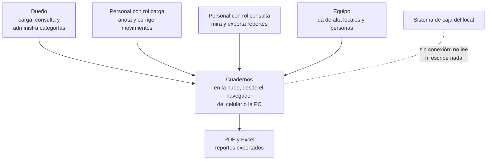
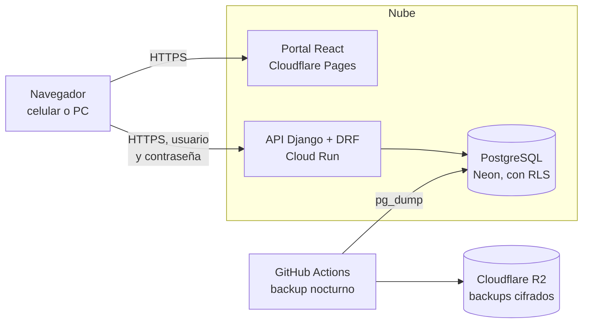
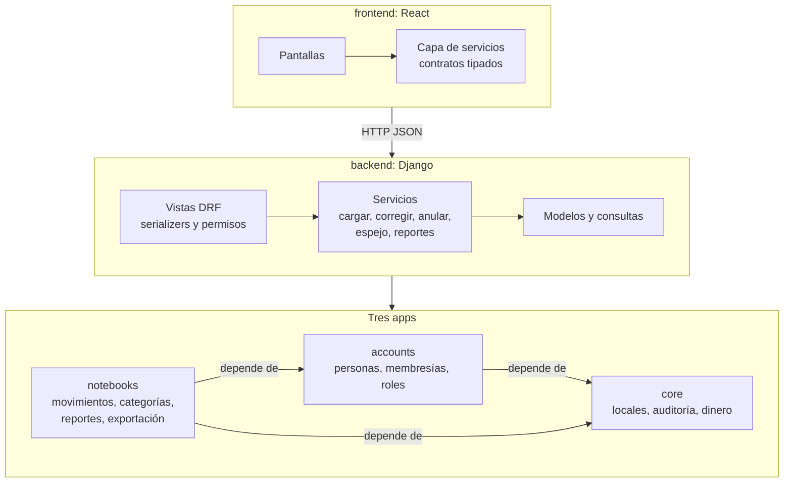
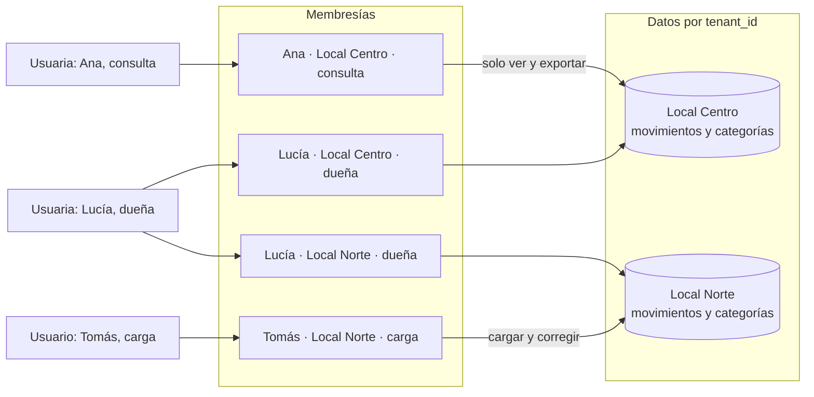
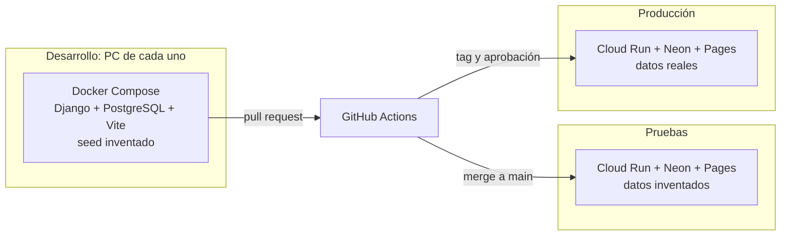

# Arquitectura: quién lo usa y qué corre dónde

**Estado: diseño objetivo.** Ningún diagrama representa código implementado todavía.

## ARQ-01. Contexto y actores

**Propósito:** presentar el sistema sin hablar de tecnología. **Stories:** HU-012, HU-013, HU-021, HU-027. **Viene de floky:** ARQ-01, sin punto de venta.

<!-- diagram: ARQ-01 -->

**Archivos ARQ-01:** [SVG](svg/ARQ-01.svg) · [PNG](png/ARQ-01.png) · [Mermaid](fuentes/ARQ-01.mmd).

**Lectura:** todos entran por internet, con usuario y contraseña, y cada uno ve solo los locales donde tiene membresía. La línea punteada con la caja es a propósito: los cuadernos no dependen de ningún otro sistema.

## ARQ-02. Contenedores: qué corre y dónde

**Propósito:** mostrar las piezas que se despliegan por separado. **Stories:** HU-003, HU-005, HU-016. **Viene de floky:** ARQ-02, sin servidor local.

<!-- diagram: ARQ-02 -->

**Archivos ARQ-02:** [SVG](svg/ARQ-02.svg) · [PNG](png/ARQ-02.png) · [Mermaid](fuentes/ARQ-02.mmd).

**Lectura:** tres piezas en la nube y un backup que vive en otro proveedor. La base es la única copia de los cuadernos (ADR-0004): por eso el backup no está en Neon sino en R2.

## ARQ-03. Capas y apps del backend

**Propósito:** separar responsabilidades y fijar en qué sentido van las dependencias. **Stories:** HU-001, HU-003, HU-020. **Viene de floky:** ARQ-03, sin apps del punto de venta.

<!-- diagram: ARQ-03 -->

**Archivos ARQ-03:** [SVG](svg/ARQ-03.svg) · [PNG](png/ARQ-03.png) · [Mermaid](fuentes/ARQ-03.mmd).

**Lectura:** las reglas de negocio viven en los servicios, no en las vistas ni en los modelos. Las flechas de las apps van en un solo sentido: `core` y `accounts` no saben que existen los cuadernos, así se pueden reutilizar en otro producto (ADR-0001, ADR-0002).

## ARQ-04. Locales como tenants

**Propósito:** explicar quién ve qué cuando hay varios locales. **Stories:** HU-010, HU-011, HU-012, HU-013. **Viene de floky:** ARQ-04, con los cuadernos por local y sin contador ni datos de venta.

<!-- diagram: ARQ-04 -->

**Archivos ARQ-04:** [SVG](svg/ARQ-04.svg) · [PNG](png/ARQ-04.png) · [Mermaid](fuentes/ARQ-04.mmd).

**Lectura:** el acceso nace de una membresía, no del nombre ni del parentesco. Lucía tiene dos membresías: al entrar elige el local. Tomás y Ana tienen una sola: entran directo y no saben que el otro local existe (FUN-01). El aislamiento se aplica dos veces: en Django y en PostgreSQL con Row Level Security (ADR-0003).

## ARQ-05. Entornos

**Propósito:** mostrar por dónde pasa un cambio hasta llegar a producción. **Stories:** HU-002, HU-005, HU-006, HU-007. **Viene de floky:** ARQ-05, sin servidor local ni ARCA.

<!-- diagram: ARQ-05 -->

**Archivos ARQ-05:** [SVG](svg/ARQ-05.svg) · [PNG](png/ARQ-05.png) · [Mermaid](fuentes/ARQ-05.mmd).

**Lectura:** nadie despliega desde su PC. Pruebas y producción tienen bases y secretos distintos (HU-007), y a producción llega el mismo artefacto que se probó.
