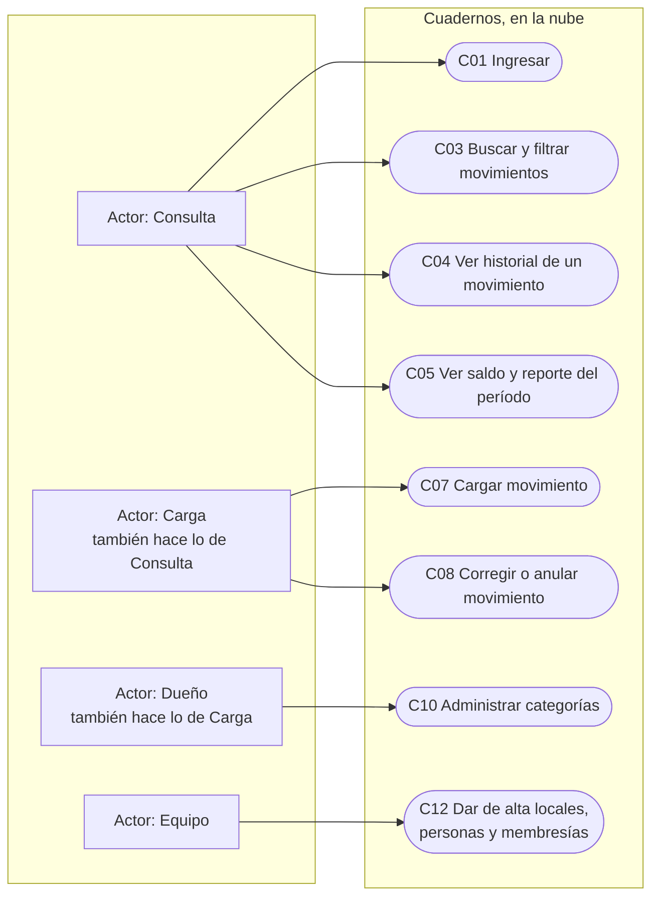
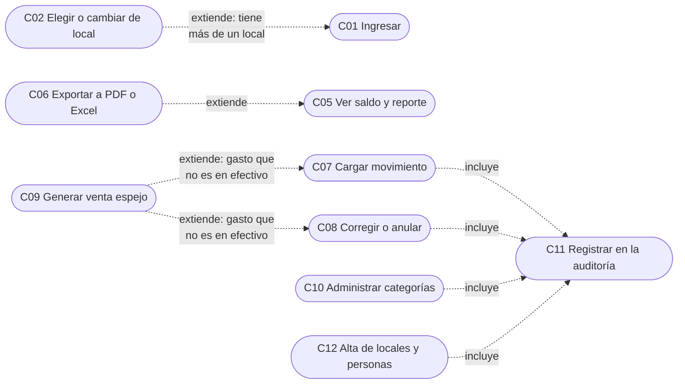

# Casos de uso

**Estado: diseño objetivo para R1.** Responde quién hace qué, sin hablar de pantallas ni de tecnología. Las reglas de cada caso están en las stories que se citan.

## CU-01. Casos de uso de los cuadernos

**Propósito:** ver de un vistazo qué puede hacer cada rol. **Stories:** HU-010, HU-012, HU-013, HU-021, HU-022, HU-023, HU-024, HU-026, HU-028, HU-029. **Viene de floky:** nueva.

<!-- diagram: CU-01 -->

**Archivos CU-01:** [SVG](svg/CU-01.svg) · [PNG](png/CU-01.png) · [Mermaid](fuentes/CU-01.mmd).

**Lectura:** los roles se apilan: carga puede todo lo de consulta, y el dueño todo lo de carga. Por eso el dueño no tiene flechas a C03 o C07: las hereda. En UML eso se dibuja con una flecha de generalización entre actores; acá va escrito en la caja para que se lea mejor. El equipo no es alguien del local: en R1 da de alta locales y personas durante la puesta en marcha.

## CU-02. Relaciones entre casos de uso

**Propósito:** mostrar qué casos se disparan desde otros. **Stories:** HU-012, HU-014, HU-025, HU-027. **Viene de floky:** nueva.

<!-- diagram: CU-02 -->

**Archivos CU-02:** [SVG](svg/CU-02.svg) · [PNG](png/CU-02.png) · [Mermaid](fuentes/CU-02.mmd).

**Lectura:** C09 y C11 no los dispara una persona sino el sistema, como parte de otro caso.

**Cómo leer las flechas punteadas:**

- **Incluye:** el caso que sale siempre ejecuta el caso al que llega. Cargar, corregir y administrar categorías siempre dejan auditoría.
- **Extiende:** el caso que sale agrega algo al caso al que llega solo cuando se cumple una condición. Elegir local pasa solo si la persona tiene más de uno; la venta espejo, solo si el gasto no es en efectivo.

> Tip: si un "incluye" tiene condición, en realidad es un "extiende". Es el error más común en estos diagramas, y obliga a preguntar "¿esto pasa siempre?", que es justo la pregunta que destapa reglas de negocio.

## Detalle de cada caso

| Caso | Actor | Qué logra | Reglas y alternativas | Stories |
|---|---|---|---|---|
| C01 Ingresar | Todos | Entrar al portal con su usuario | Credenciales inválidas: rechazo sin decir qué falló. Sin membresías activas: no entra a ningún local | HU-012 |
| C02 Elegir o cambiar de local | Todos con más de un local | Trabajar en el local que corresponde | Con un solo local no aparece. Pedir un local ajeno responde 404 | HU-012, HU-013, HU-011 |
| C03 Buscar y filtrar | Consulta | Encontrar movimientos | Por fechas, categoría, tipo, medio y texto. Los anulados se ven marcados | HU-028 |
| C04 Ver historial | Consulta | Saber quién cambió qué y por qué | Muestra antes, después, motivo, persona y hora | HU-026 |
| C05 Ver saldo y reporte | Consulta | Totales por mes y por categoría, ingresos contra gastos | Los espejos suman, los anulados no | HU-023 |
| C06 Exportar | Consulta | Llevarse el reporte en PDF o Excel | Respeta el período y los filtros en pantalla | HU-027 |
| C07 Cargar movimiento | Carga | Anotar un ingreso, gasto o haber | Datos inválidos: no se guarda nada. Un doble toque guarda uno solo | HU-021 |
| C08 Corregir o anular | Carga | Arreglar un error sin esconderlo | Siempre con motivo. Nada se borra. La venta espejo no se toca sola | HU-026 |
| C09 Generar venta espejo | Sistema | Que el saldo no baje por un gasto que no salió del cajón | Solo gastos con débito, crédito, QR o transferencia. Mismo importe y fecha | HU-025 |
| C10 Administrar categorías | Dueño | Ordenar los movimientos como piensa el negocio | Una categoría con movimientos se desactiva, no se borra | HU-022 |
| C11 Registrar en la auditoría | Sistema | Que todo cambio quede registrado | En la misma transacción que el cambio | HU-014, HU-024 |
| C12 Alta de locales y personas | Equipo | Dejar listo el acceso de cada persona | Una membresía por persona y local, con su rol | HU-010, HU-013, HU-029 |
