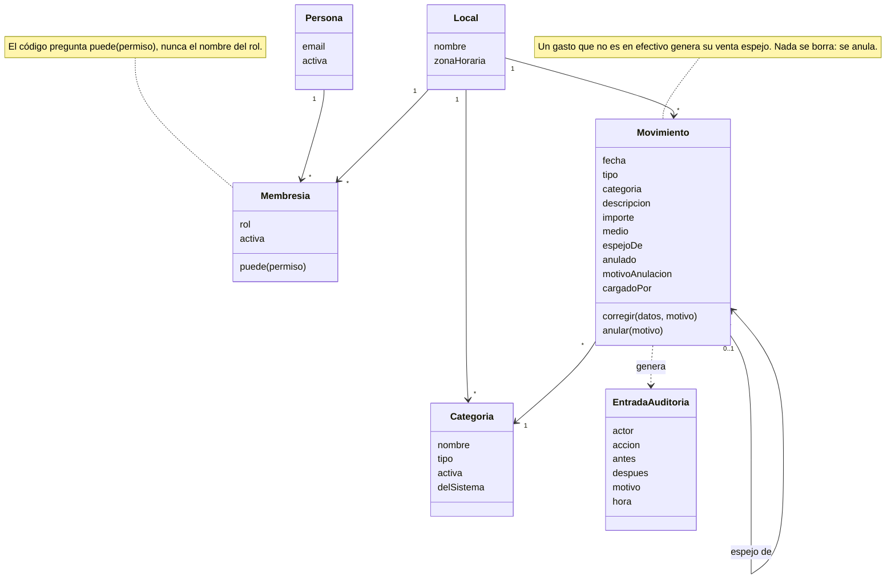

# Clases del dominio

**Estado: diseño objetivo.** Muestra responsabilidades, no código que exista.

## CLA-01. Locales, personas y cuadernos

**Propósito:** decidir quién es responsable de cada regla. **Stories:** HU-013, HU-020, HU-022, HU-025. **Viene de floky:** CLA-02, solo Mis finanzas, más personas y membresías.

<!-- diagram: CLA-01 -->

**Archivos CLA-01:** [SVG](svg/CLA-01.svg) · [PNG](png/CLA-01.png) · [Mermaid](fuentes/CLA-01.mmd).

**Lectura:** el movimiento sabe corregirse y anularse, y al hacerlo arrastra a su venta espejo (`espejoDe`). La membresía es la única puerta: responde si una persona puede algo en un local. La auditoría es de solo agregar.
