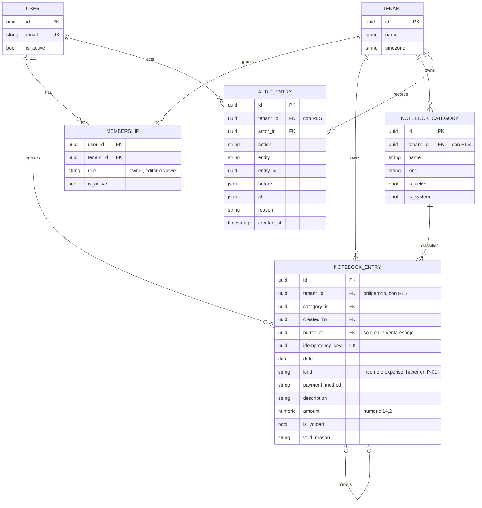

# Datos

**Estado: diseño objetivo.** Nombres de tablas y columnas en inglés, como en el código.

## DAT-01. Base de datos

**Propósito:** mostrar qué se guarda, cómo se relaciona y cómo se aísla cada local. **Stories:** HU-010, HU-011, HU-013, HU-014, HU-020, HU-025. **Viene de floky:** DAT-02, solo Mis finanzas y membresías, más la auditoría de DAT-01.

<!-- diagram: DAT-01 -->

**Archivos DAT-01:** [SVG](svg/DAT-01.svg) · [PNG](png/DAT-01.png) · [Mermaid](fuentes/DAT-01.mmd).

**Lectura:** `MEMBERSHIP` es la única puerta a un local. Todas las tablas de negocio tienen `tenant_id` y Row Level Security (ADR-0003). `mirror_of` une la venta espejo con su gasto para corregirlas y anularlas juntas; `is_system` marca la categoría de los espejos, que nadie edita. `AUDIT_ENTRY` es de solo agregar: la app no tiene permiso para modificarla ni borrarla, y de ahí sale el historial que ve la persona. `idempotency_key` evita que un doble toque cree dos movimientos.
