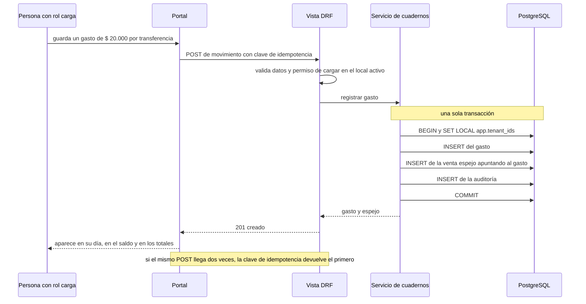
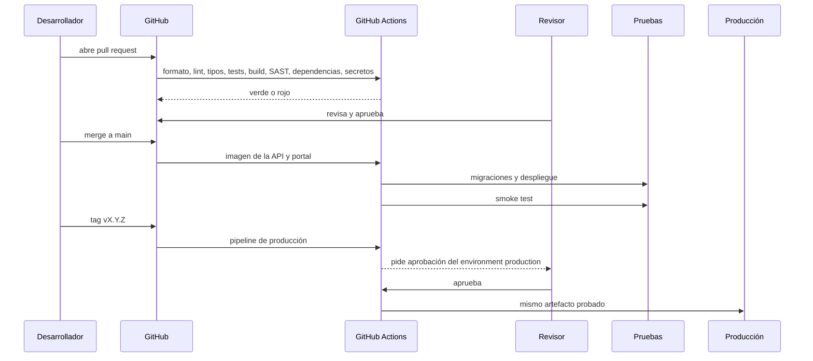

# Secuencias técnicas

**Estado: diseño objetivo.** Muestran el orden en que colaboran las piezas y dónde empieza y termina cada transacción.

## TEC-01. Guardar un gasto con venta espejo

**Propósito:** mostrar que el gasto, su espejo y la auditoría se guardan juntos o no se guarda nada. **Stories:** HU-011, HU-014, HU-021, HU-025. **Viene de floky:** Nueva, con la idea de TEC-01.

<!-- diagram: TEC-01 -->

**Archivos TEC-01:** [SVG](svg/TEC-01.svg) · [PNG](png/TEC-01.png) · [Mermaid](fuentes/TEC-01.mmd).

**Lectura:** la persona ve "guardado" recién después del COMMIT. Si algo falla en el medio, no queda un gasto sin espejo ni un espejo suelto. El `SET LOCAL` hace que la base solo deje tocar filas del local activo, aunque el código se equivoque.

## TEC-02. CI/CD de punta a punta

**Propósito:** mostrar qué valida cada paso antes de llegar a producción. **Stories:** HU-004, HU-005, HU-006. **Viene de floky:** TEC-05, sin instalador.

<!-- diagram: TEC-02 -->

**Archivos TEC-02:** [SVG](svg/TEC-02.svg) · [PNG](png/TEC-02.png) · [Mermaid](fuentes/TEC-02.mmd).

**Lectura:** nadie mergea su propio PR y nadie aprueba su propio despliegue. A producción llega exactamente lo que pasó por pruebas, sin recompilar.
