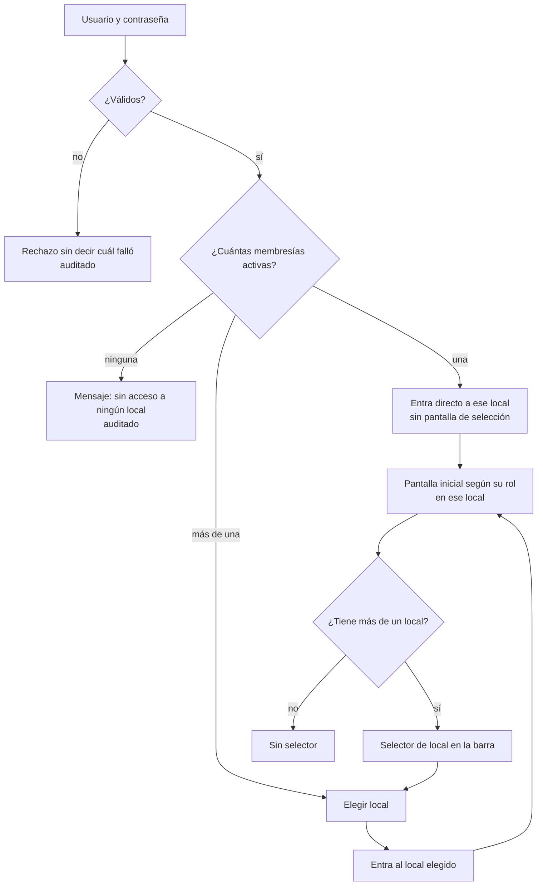
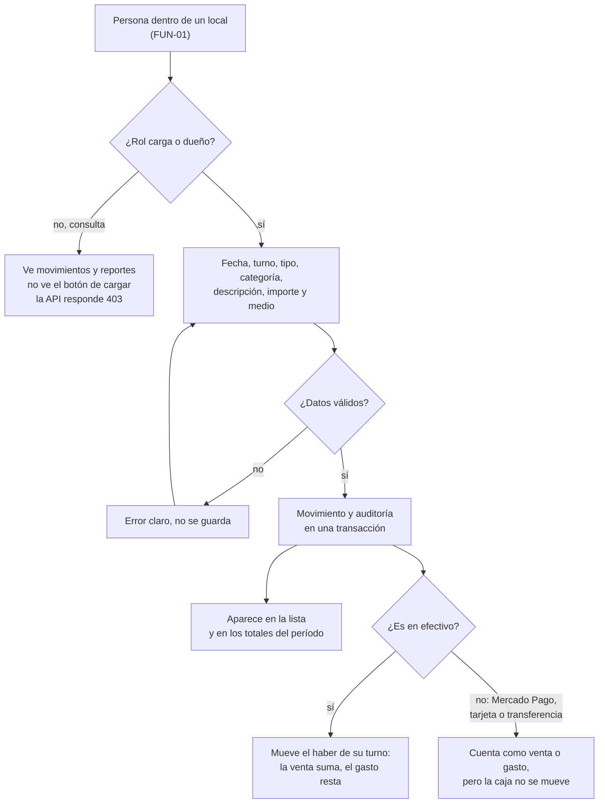
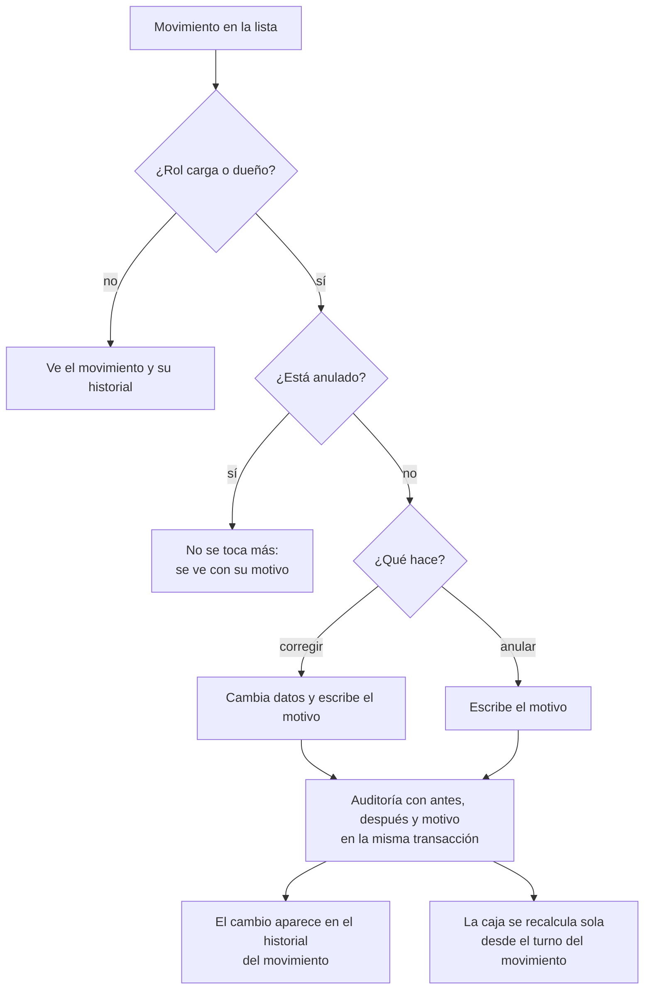

# Flujos funcionales: lo que hace la persona

**Estado: diseño objetivo.** Cada flujo muestra decisiones y qué pasa ante errores.

## FUN-01. Ingresar y elegir local

**Propósito:** definir qué pantalla ve cada persona al entrar. **Stories:** HU-011, HU-012, HU-013. **Viene de floky:** nueva, a partir del ingreso de FUN-07.

<!-- diagram: FUN-01 -->

**Archivos FUN-01:** [SVG](svg/FUN-01.svg) · [PNG](png/FUN-01.png) · [Mermaid](fuentes/FUN-01.mmd).

**Lectura:** la cantidad de membresías activas decide la pantalla, no el rol. Una dueña con dos locales elige al entrar y puede cambiar sin volver a ingresar; una persona con un solo local nunca ve la selección ni se entera de que hay otros. Los permisos cambian con el local: se puede ser dueño en uno y consulta en otro. Si alguien fuerza el id de un local ajeno en la URL o en la API, recibe 404 (HU-011). Si se entra con email o con nombre de usuario está abierto (P-03).

## FUN-02. Cargar un movimiento

**Propósito:** seguir la carga desde el permiso hasta que aparece en los totales y en la caja. **Stories:** HU-021, HU-024, HU-025. **Viene de floky:** FUN-06, sin segunda clave.

<!-- diagram: FUN-02 -->

**Archivos FUN-02:** [SVG](svg/FUN-02.svg) · [PNG](png/FUN-02.png) · [Mermaid](fuentes/FUN-02.mmd).

**Lectura:** la persona carga cada movimiento una sola vez, con su medio de pago, y el sistema decide si toca la caja (ADR-0008, HU-025). En Comedor TJ, un gasto con D (pagado con débito) se carga con Débito y el sistema suma su venta con débito por el mismo monto, como el renglón aparte que el dueño escribe en el cuaderno (ADR-0010).

## FUN-03. Corregir o anular un movimiento

**Propósito:** definir qué pasa al corregir o anular, y con la caja. **Stories:** HU-024, HU-025, HU-026. **Viene de floky:** nueva.

<!-- diagram: FUN-03 -->

**Archivos FUN-03:** [SVG](svg/FUN-03.svg) · [PNG](png/FUN-03.png) · [Mermaid](fuentes/FUN-03.mmd).

**Lectura:** nada se borra: se corrige o se anula, siempre con motivo. Como el haber se calcula y no se guarda, no hay nada más que mantener en orden: si un gasto en efectivo pasa a ser por transferencia, la caja de ese turno y de los siguientes cambia sola. El historial que ve la persona se arma con la auditoría (HU-014): no hace falta otra tabla.
