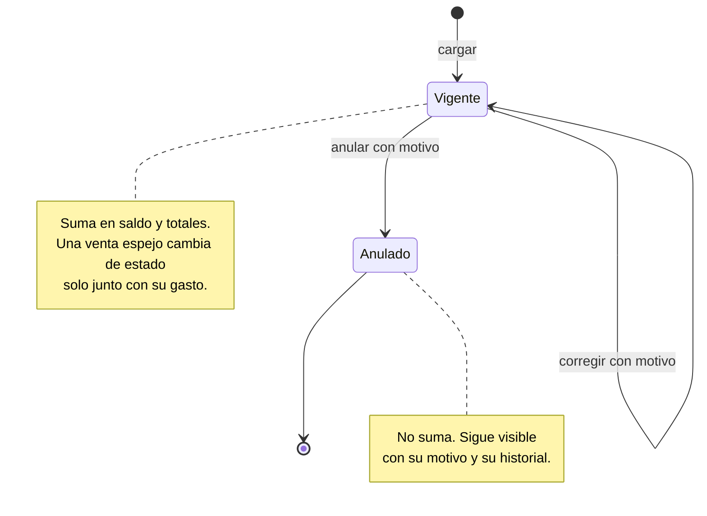

# Estados

**Estado: diseño objetivo.** Qué cambios de estado son válidos. Lo que no está dibujado, no se permite.

## EST-01. Estados de un movimiento

**Propósito:** fijar qué se puede hacer con un movimiento en cada momento. **Stories:** HU-025, HU-026. **Viene de floky:** Nueva.

<!-- diagram: EST-01 -->

**Archivos EST-01:** [SVG](svg/EST-01.svg) · [PNG](png/EST-01.png) · [Mermaid](fuentes/EST-01.mmd).

**Lectura:** un movimiento anulado no vuelve a vigente: si se anuló por error, se carga de nuevo. Así el historial siempre se lee de arriba hacia abajo, sin idas y vueltas. Si en la revisión hace falta reactivar, se agrega la transición y su motivo en un PR.
