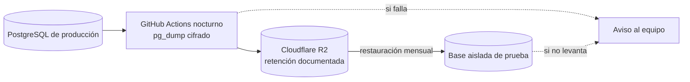

# Operación

**Estado: diseño objetivo.** Cómo se cuida que los datos no se pierdan.

## OPS-01. Backups y restauración probada

**Propósito:** mostrar de dónde sale cada backup y cómo se prueba. **Stories:** HU-016, HU-029. **Viene de floky:** OPS-02, sin la parte del local.

<!-- diagram: OPS-01 -->

**Archivos OPS-01:** [SVG](svg/OPS-01.svg) · [PNG](png/OPS-01.png) · [Mermaid](fuentes/OPS-01.mmd).

**Lectura:** la nube es la única copia de los cuadernos (ADR-0004). El backup vive en otro proveedor, así un problema con la cuenta de la base no se lleva también los backups. Un backup que nunca se restauró no cuenta.
