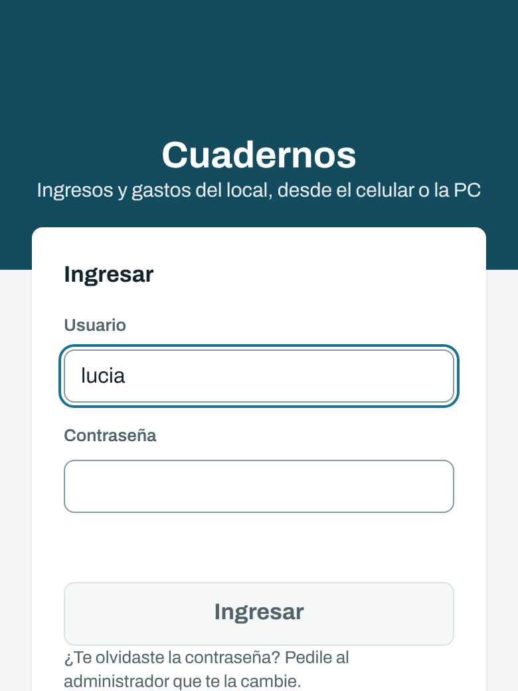
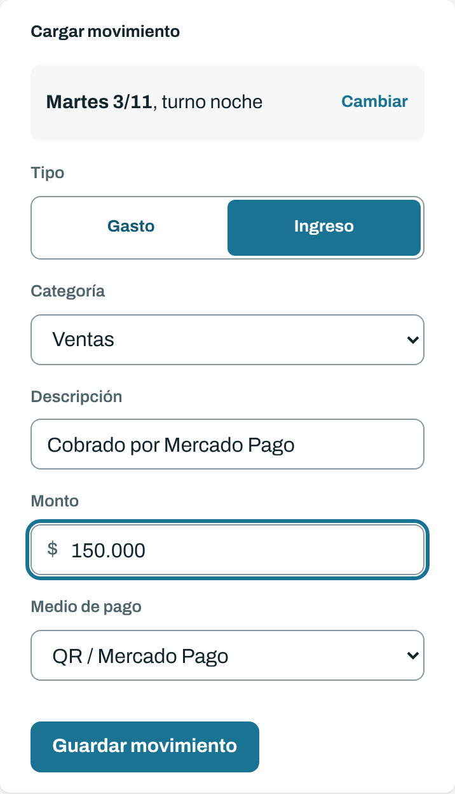
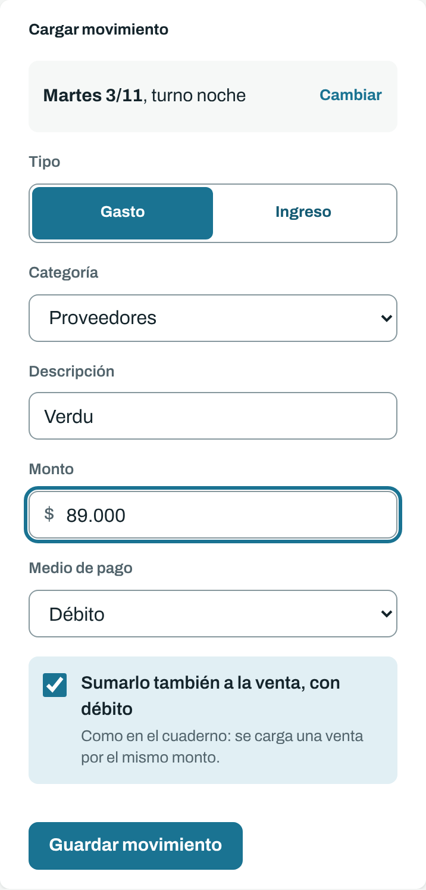
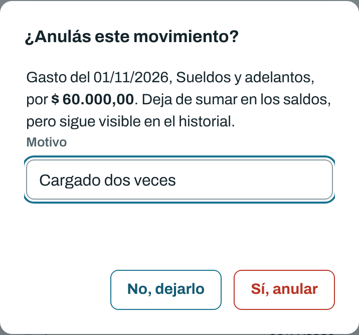
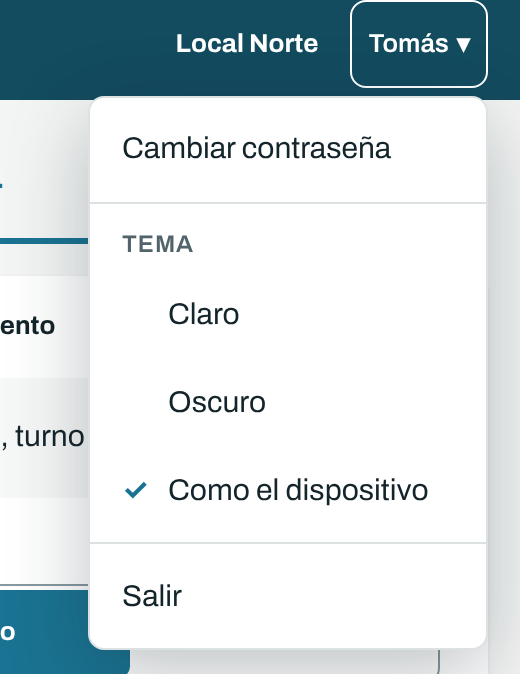

# Cuadernos: guía para quien carga

Para la persona que anota las ventas y los gastos del local.

## Entrar

Abrí la dirección que te pasamos, en el celular o en la compu, y escribí tu usuario y tu contraseña. Si trabajás en un solo local, entrás directo.

¿Te olvidaste la contraseña? Avisale al dueño del local: se la pide al equipo.

 

## Cargar una venta o un gasto

Al entrar estás en la solapa **Cargar**: el formulario arriba y, al lado (o abajo en el celular), lo que ya se cargó ese día.

1. **Fecha y turno.** Arriba del formulario dice qué día y qué turno se está cargando. Si hay que cambiarlo, tocá **Cambiar**. El turno noche que termina después de las 12 va con la fecha en que empezó. Si la fecha no es la de hoy, aparece el aviso **No es hoy**.
2. **Tipo:** gasto o ingreso (las ventas son ingresos).
3. **Categoría** y, si querés, una **descripción** ("verdura", "ventas del turno"). Al escribir la descripción aparecen las que ya se usaron: elegí una con las flechas y Enter, o tocándola. Así los nombres quedan iguales y después se filtran mejor.
4. **Monto.** Escribilo como siempre: `45.000` o `45.000,50`.
5. **Medio de pago.** Decide si la plata entra o sale de la caja: Efectivo la mueve; débito, tarjeta, Mercado Pago o transferencia no. Los renglones con D van con **Débito** (mirá abajo).
6. **Guardar movimiento.** En la compu también se guarda con Enter.

Después de guardar, la fecha, el turno, el tipo y el medio de pago quedan como estaban, así pasás el cuaderno renglón por renglón sin volver a elegirlos. El movimiento nuevo aparece marcado en la lista del día, con el total de ingresos y gastos de ese día para comparar con el papel.

 

## Los renglones con D y las transferencias

En el cuaderno de Costos, la D al final de un gasto quiere decir que se pagó con débito. El dueño lo anota dos veces: el gasto y, en el cuaderno de ventas, una venta por el mismo monto.

En el sistema se carga **una sola vez**:

1. Tipo **Gasto**, la categoría, el monto y medio de pago **Débito**.
2. Dejá marcado **Sumarlo también a la venta, con débito**. El sistema carga la venta solo.
3. Al pasar el cuaderno de ventas, **saltá el renglón de esa venta**: ya está cargado.

Por ejemplo, "Verdu 89.000 D" queda como un gasto de Proveedores por $ 89.000 con Débito, y una venta de $ 89.000 con Débito que dice "Gasto con débito: Proveedores". Ninguno de los dos mueve la caja, igual que en el papel.

Los gastos pagados **por transferencia** funcionan igual: elegí Transferencia y dejá el tilde marcado. La venta se carga por transferencia ("Gasto por transferencia: Proveedores").

Si después corregís o anulás el gasto, su venta se corrige o se anula con él. La venta sola no se puede tocar. Si corregís un gasto y lo pasás a Débito o Transferencia, la ventana te ofrece el mismo tilde para sumar su venta.

Con cualquier gasto que no sea en efectivo aparece el mismo tilde: con débito y transferencia viene marcado, y con crédito o Mercado Pago sin marcar. Si ese gasto también lo sumás a la venta en el cuaderno, tildalo. Con efectivo no aparece, porque ese gasto sale de la caja.

 

## Si te equivocaste

Nada se borra. Cada movimiento tiene un botón **⋯** con estas opciones:

- **Corregir:** cambiás lo que estaba mal y escribís el motivo ("el ticket decía 48.000").
- **Historial:** quién cargó o cambió el movimiento, cuándo y por qué.
- **Anular:** para algo cargado dos veces o que no iba. También pide motivo. Deja de sumar, pero sigue a la vista.

 

## La caja

La caja de cada turno está en la solapa **Reportes**, igual que en el cuaderno: el haber del turno anterior, más las ventas, menos lo cobrado sin efectivo y los gastos en efectivo. Se calcula sola.

Si un turno aparece en rojo con **Revisar**, la caja dio negativa: casi siempre falta cargar una venta o hay un gasto de más. Revisá ese turno.

## Tu cuenta

Tocando tu nombre, arriba a la derecha, tenés:

- **Cambiar contraseña.** Te pide la actual y la nueva dos veces. Si tenías la sesión abierta en otro celular o compu, ahí se cierra.
- **Tema:** claro, oscuro o como esté el celular o la compu.
- **Salir.**

 
