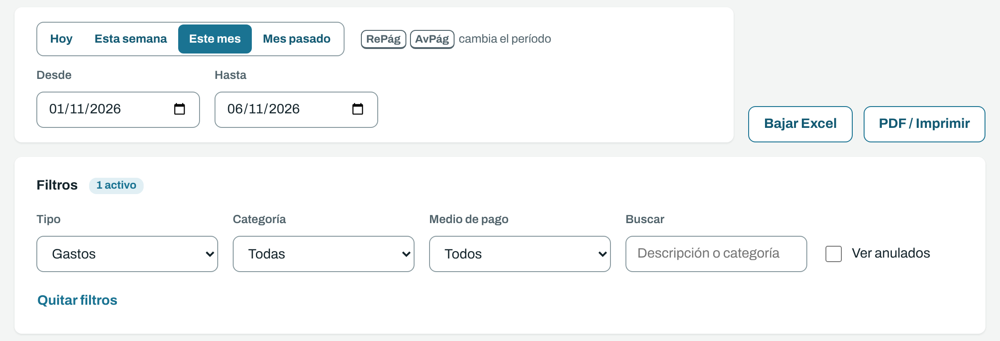
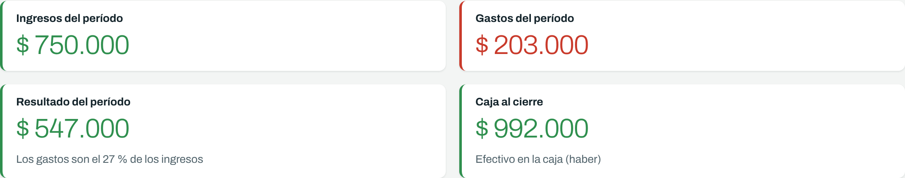
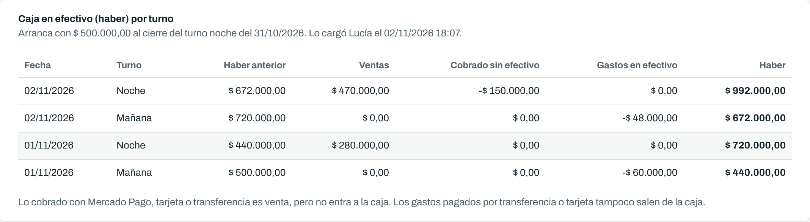
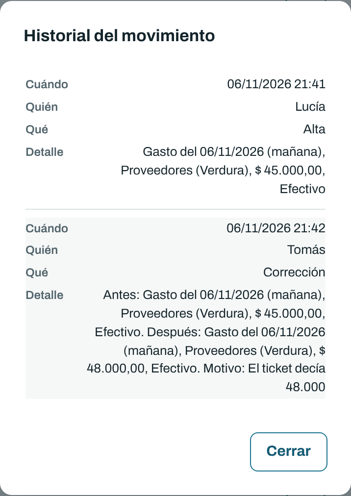

# Cuadernos: guía para consultar

Para quien mira los números del local sin cargar nada (por ejemplo, el contador). Con este permiso se ve todo y se puede exportar, pero no se puede cargar, corregir ni anular.

## Entrar

Abrí la dirección que te pasamos y escribí tu usuario y tu contraseña. Si tenés acceso a más de un local, elegís cuál ver; después lo cambiás desde la barra de arriba.

Tocando tu nombre, arriba a la derecha, podés cambiar tu contraseña, elegir el tema (claro u oscuro) y salir.

## La caja de hoy

Arriba de Reportes, en una burbuja, está **Caja hoy**: el efectivo que hay ahora en la caja. No cambia con el período ni con los filtros, y queda a la vista aunque bajes por la lista. Cuenta todo hasta hoy; lo cargado con fecha futura todavía no. Se actualiza sola cada 15 segundos, aunque cargue otra persona. Con el ojito tapás el número por si alguien mira la pantalla, y queda tapado en ese dispositivo hasta que lo vuelvas a tocar.

## Elegir el período y filtrar

- **Período:** Hoy, Esta semana, Este mes, Mes pasado, o las fechas que quieras en Desde y Hasta. Reportes arranca siempre en **Hoy**; si elegís otro período y cambiás de solapa, al volver está otra vez en Hoy.
- **Filtros:** tipo (ingresos o gastos), categoría, medio de pago, o una palabra de la descripción. Con **Ver anulados** aparecen también los movimientos anulados, marcados; nunca suman.
- Los totales, la lista y el Excel siguen el período y los filtros.
- El período puede ser de hasta un año. En períodos largos, la lista aparece de a 200 renglones, con el botón **Ver más** al pie; los totales y el Excel siempre incluyen todo.

## Los totales

- **Resultado:** ingresos menos gastos, cobrados o pagados como sea. Es lo que ganó o perdió el local.
- **Caja al cierre:** el efectivo que había en la caja al terminar el período (el haber). No es lo mismo que el resultado: lo cobrado por Mercado Pago, por ejemplo, suma al resultado pero no está en la caja.

## La caja por turno

Cada renglón es un cierre de caja: haber anterior, más ventas, menos lo cobrado sin efectivo y los gastos en efectivo, igual al haber. La caja no sigue los filtros: siempre es la caja entera del local. Se ven los últimos turnos primero, y los anteriores con **Ver turnos más**.

## Historial y exportar

- **Historial**, en el botón **⋯** de cada movimiento: quién lo cargó, quién lo cambió, cuándo y por qué.
- **Bajar Excel:** un archivo con los movimientos del período (fechas e importes listos para sumar), una hoja de totales y una hoja con la caja por turno.
- **PDF / Imprimir:** abre la impresión del navegador. Para tener el PDF, elegí "Guardar como PDF".

 
