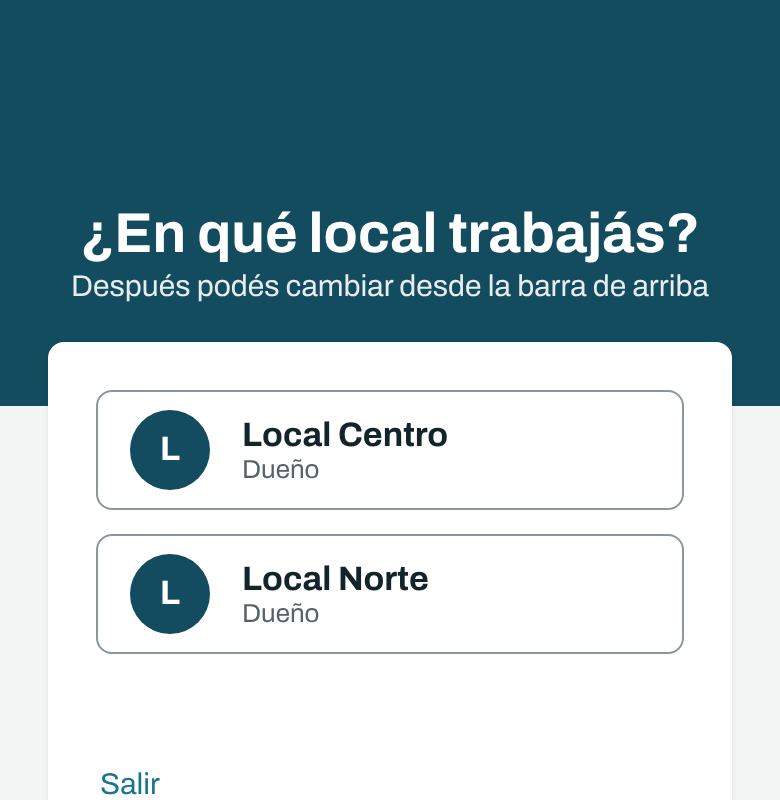
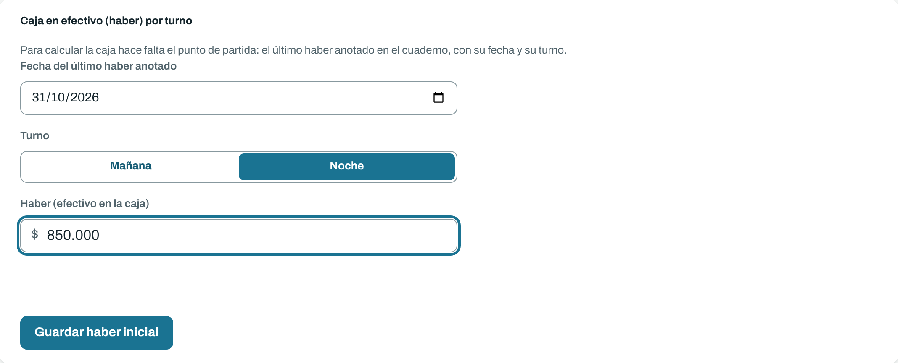
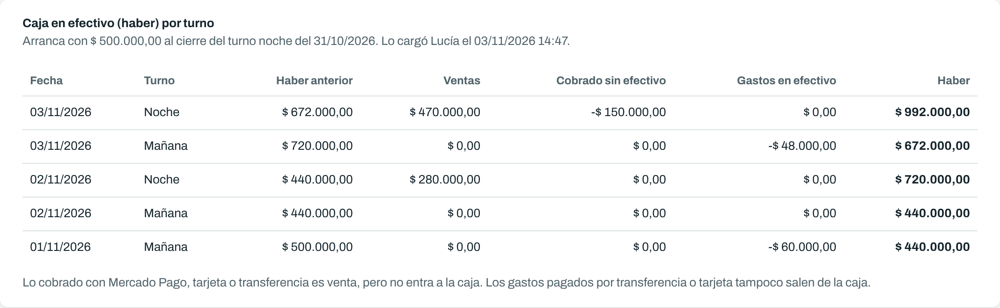
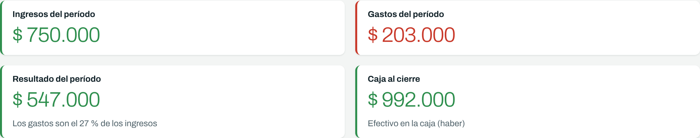
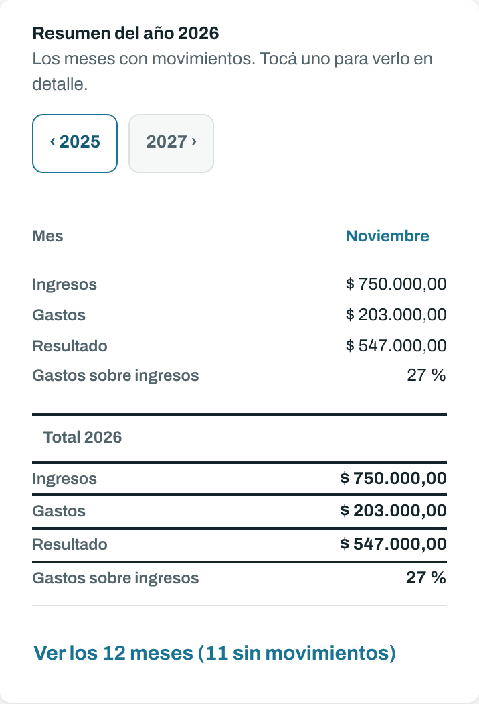

# Cuadernos: guía para el dueño

Como dueño podés hacer todo lo de la [guía para quien carga](carga.md) y lo de la [guía para consultar](consulta.md). Acá está lo que es solo tuyo.

## Elegir el local

Al entrar elegís en qué local trabajar. Después lo cambiás en cualquier momento desde la barra de arriba, sin salir.

Cada local tiene sus movimientos, sus categorías y su caja. Lo de un local nunca se mezcla con el otro.

 

## Antes de empezar: el haber inicial

La caja del sistema arranca del **último haber que anotaste en el cuaderno**. Se carga una sola vez por local, en la solapa **Reportes**: la fecha, el turno (mañana o noche) y el monto.

Desde ese turno en adelante, la caja se calcula sola con lo que se carga. Si después ves que lo copiaste mal, usá **Cambiar haber inicial**: te pide el motivo, porque cambia el haber de todos los turnos siguientes, y queda anotado quién lo cambió.

## Cómo se lee la caja

Es la misma cuenta que hacés en el cuaderno, turno por turno:

| En el cuaderno | En el sistema |
|---|---|
| Haber anterior | Haber anterior |
| Venta del turno (todo junto) | Ventas |
| Lo que restabas como "MP" | Cobrado sin efectivo (Mercado Pago, tarjeta, transferencia) |
| Costos | Gastos en efectivo |
| Haber nuevo | Haber |

La diferencia es que acá no hace falta restar a mano lo de Mercado Pago: alcanza con cargar cada venta con su medio de pago. Los gastos pagados por transferencia o tarjeta tampoco bajan la caja.

Si un turno sale en rojo con **Revisar**, la caja dio negativa: falta una venta o sobra un gasto.

## Resultado y caja no son lo mismo

- **Resultado:** lo que ganó o perdió el local en el período, con todas las ventas y todos los gastos.
- **Caja al cierre:** el efectivo que hay en la caja.

## El año completo

En **Resumen del año** ves cada mes con sus ingresos, gastos y resultado, y qué parte de lo que entró se fue en gastos. Tocá un mes para verlo en detalle. Con las flechas pasás al año anterior.

Aparecen solo los meses con movimientos; **Ver los 12 meses** los muestra todos.

 

## Categorías nuevas

Si al cargar falta una categoría, elegí **+ Nueva categoría…** al final de la lista. Queda solo en este local y ya la pueden usar todos los que cargan. Si escribís una que ya existe (aunque sea con otras mayúsculas), te avisa.

## Personas

Por ahora, para dar de alta a alguien o cambiarle el permiso, avisanos y lo hacemos nosotros. Hay tres permisos: **dueño** (todo, incluido el haber inicial y las categorías nuevas), **carga** (carga, corrige y anula movimientos) y **consulta** (mira y exporta, pero no cambia nada).
